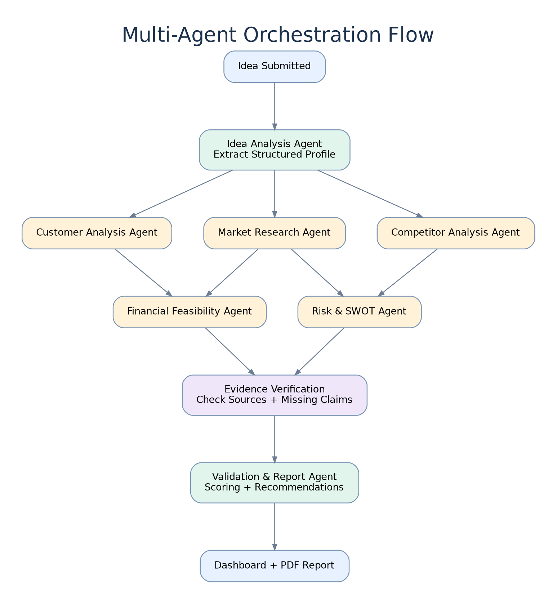

# Agent Roles and Contracts

All agents should return schema-validated JSON with `run_id`, `agent_name`, `status`, `result`, `sources`, `assumptions`, `confidence`, and `errors`. Confidence represents evidence quality, not the probability of startup success.

## 1. Idea Analysis Agent
**Input:** free-text startup idea and optional structured form fields.
**Responsibilities:** identify problem, solution, audience, industry, region, revenue model, differentiators, and missing details. Do not invent user-provided facts.
**Output:** normalized idea profile and clarification questions.

## 2. Market Research Agent
**Input:** normalized profile and search adapter.
**Responsibilities:** find current market signals, trends, regional constraints, and available market size evidence. Distinguish sourced TAM/SAM/SOM from estimated values.
**Output:** market findings, source links, dates, estimates, methods, and uncertainties.

## 3. Competitor Analysis Agent
**Input:** profile and web search results.
**Responsibilities:** identify direct and indirect competitors, compare publicly documented positioning, features, and pricing. Mark unavailable pricing as unknown.
**Output:** competitor list, comparison matrix, gaps, and citations.

## 4. Customer Analysis Agent
**Input:** profile, market findings, and competitor findings.
**Responsibilities:** hypothesize segments, customer jobs/pain points, channels, and interview questions. Never present synthetic personas as real interviews.
**Output:** customer hypotheses and validation experiments.

## 5. Financial Feasibility Agent
**Input:** profile, market and customer findings, founder budget if provided.
**Responsibilities:** model startup cost, fixed/variable cost, revenue scenarios, unit economics, and break-even assumptions.
**Output:** low/base/high scenarios with transparent formulas and missing inputs.

## 6. Risk & SWOT Agent
**Input:** profile, market, competitor, customer, and financial findings.
**Responsibilities:** analyze operational, market, regulatory, privacy, technical, and execution risks; develop mitigation steps.
**Output:** SWOT matrix and prioritized risk register.

## 7. Validation & Report Agent
**Input:** verified outputs from all agents.
**Responsibilities:** combine findings, surface contradictions, calculate a transparent weighted score, and recommend practical next tests.
**Output:** score breakdown, evidence confidence, recommendation, MVP experiment plan, and report JSON.

## Shared tool interfaces
- `search_web(query, region?, recency?) -> [{title, url, snippet, retrieved_at}]`
- `save_agent_result(run_id, agent_name, output) -> execution_id`
- `load_run_context(run_id) -> {idea_profile, completed_results}`
- `verify_claims(claims, sources) -> verification_results`

## Failure handling
A failed agent returns a structured error. The orchestrator retries transient failures within limits, records persistent failures, and produces a partial report when feasible. Missing data is never silently replaced by generated facts.

## Visual Diagrams

