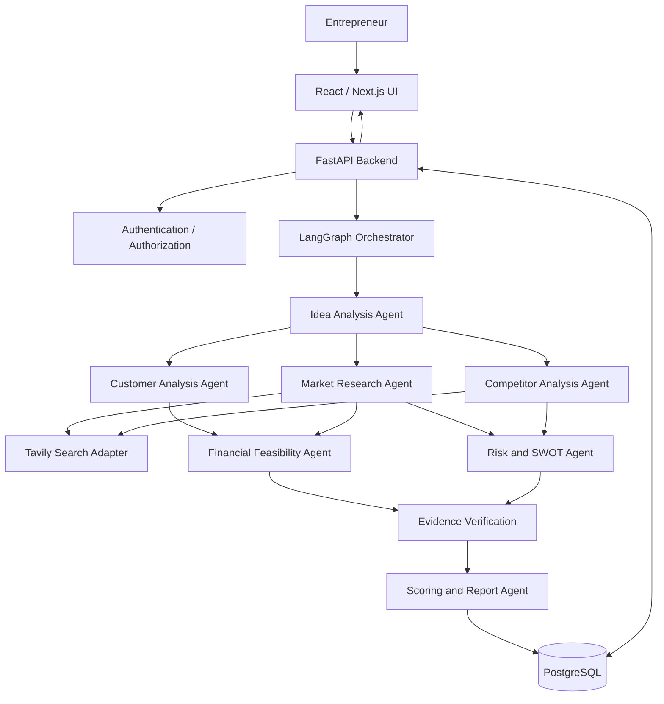
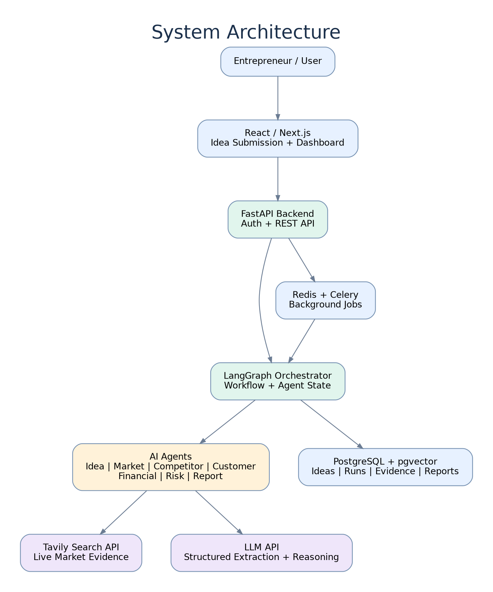

# System Architecture Diagram

The diagram below is written in Mermaid, which GitHub renders directly in Markdown.

## Integration boundaries
- **Idea submission / extraction:** owned by the idea-submission teammate; connect via a normalized idea profile.
- **Search adapter:** owned by the Tavily agent teammate; expose a structured search result with URLs and timestamps.
- **Architecture and data contracts:** documented here; coordinate migrations and naming before implementation.

## Nonfunctional requirements
Source attribution, traceable agent executions, API key security, per-user access controls, bounded retries, and transparent handling of missing evidence.

## Visual Diagrams

