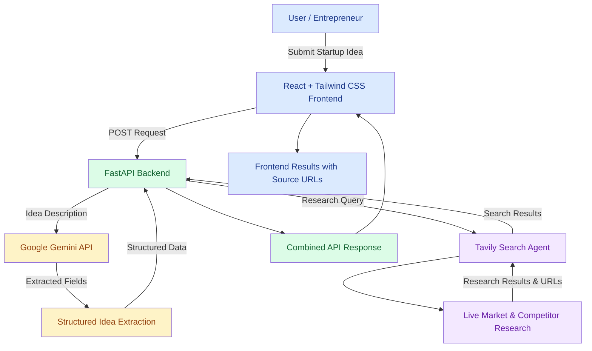
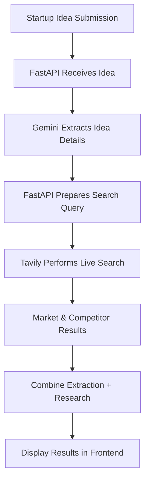

# System Architecture Diagram — Milestone 1

## Project
AI-Based Startup Idea Validator with Market Analysis Assistance

## 1. System Overview

The system helps entrepreneurs analyze startup ideas using AI-based idea extraction and live web research.

Milestone 1 focuses on:
- Startup idea submission
- Structured idea extraction using Gemini
- Live market research using Tavily
- Competitor information retrieval
- Displaying results with source URLs

## 2. Technology Stack

| Component | Technology | Purpose |
|---|---|---|
| Frontend | React + Tailwind CSS | User interface |
| Backend | Python FastAPI | API and request handling |
| AI Model | Google Gemini | Startup idea extraction |
| Search Agent | Tavily API | Live market and competitor research |

## 3. System Architecture Diagram

## 4. Component Responsibilities

### React + Tailwind CSS Frontend
- Accepts startup ideas from users.
- Sends the idea to the FastAPI backend.
- Displays structured startup information.
- Displays market and competitor research with source URLs.

### FastAPI Backend
- Receives the submitted startup idea.
- Communicates with the Gemini API.
- Passes extracted fields to the Tavily search agent.
- Combines idea extraction and research results.
- Returns the combined response to the frontend.

### Gemini Idea Extraction
- Analyzes the startup idea description.
- Extracts the problem statement.
- Identifies the proposed solution.
- Identifies the target audience.
- Identifies the industry and business concept.
- Returns structured information.

### Tavily Search Agent
- Accepts extracted startup information.
- Performs live market research.
- Searches for competitor information.
- Returns research summaries and source URLs.

## 5. Milestone 1 Orchestration Flow

### Workflow Explanation

1. The entrepreneur enters a startup idea.
2. React sends the idea to FastAPI.
3. Gemini extracts structured startup details.
4. FastAPI prepares research queries from those details.
5. Tavily retrieves market and competitor information.
6. FastAPI combines the extraction and research results.
7. React displays the results with source URLs.

## 6. Integration Status

The Milestone 1 components include:
- React and Tailwind frontend
- FastAPI backend
- Gemini-based idea extraction
- Standalone Tavily search agent

The end-to-end Gemini-to-Tavily integration and combined frontend response are Milestone 1 integration tasks.

The architecture above represents the intended integrated workflow. Integration should only be marked complete after successful end-to-end testing.

## 7. Planned Features — Future Milestones

The following components are planned and are not part of the current Milestone 1 implementation:

- LangGraph multi-agent orchestration
- User authentication and authorization
- Next.js as a possible future frontend alternative
- Customer Analysis Agent
- Financial Feasibility Agent
- Risk and SWOT Analysis Agent
- Validation Scoring Agent
- Automated report generation
- Advanced database integration

## 8. Conclusion

Milestone 1 establishes the foundation for AI-based startup idea validation using React, FastAPI, Gemini, and Tavily.

The system is designed to extract startup information and provide live market and competitor research with source references.

Future milestones will extend this foundation with additional AI agents, advanced orchestration, feasibility analysis, and validation reports.
