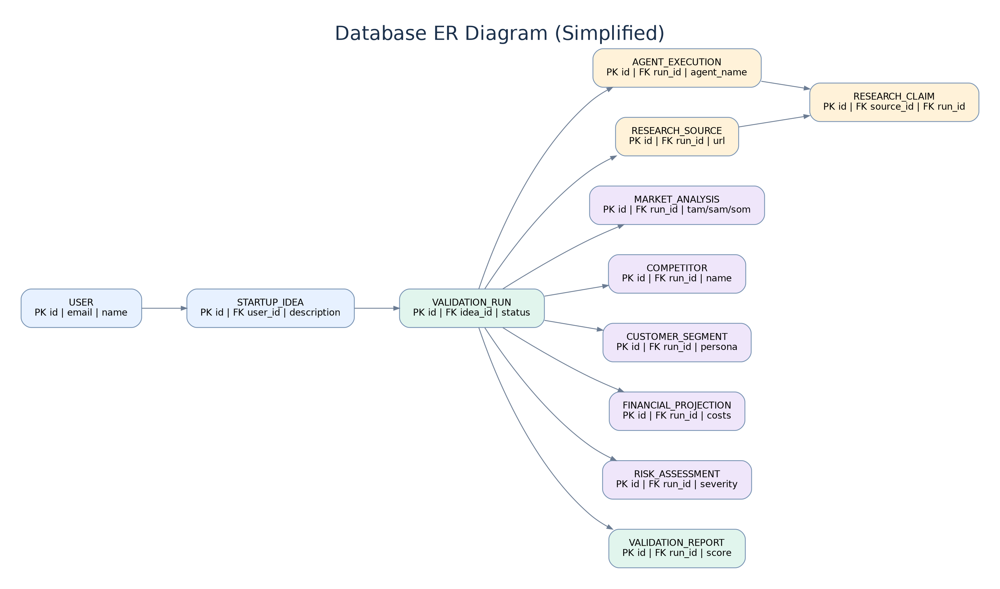

# Data Models

## Storage approach
PostgreSQL stores relational entities; JSONB stores flexible agent findings. Use UUID primary keys, UTC timestamps, foreign keys, and indexes on ownership, run status, and execution lookup. These are proposed schemas to align with existing team code before migrations are written.

## Entities

### User
`id UUID PK`, `name TEXT`, `email TEXT UNIQUE`, `password_hash TEXT`, `created_at TIMESTAMPTZ`.

### StartupIdea
`id UUID PK`, `user_id UUID FK -> User.id`, `title TEXT`, `description TEXT`, `industry TEXT NULL`, `target_region TEXT NULL`, `target_audience TEXT NULL`, `business_model TEXT NULL`, `budget_amount NUMERIC NULL`, `budget_currency CHAR(3) NULL`, `created_at TIMESTAMPTZ`, `updated_at TIMESTAMPTZ`.

### ValidationRun
`id UUID PK`, `idea_id UUID FK -> StartupIdea.id`, `status TEXT`, `started_at TIMESTAMPTZ NULL`, `completed_at TIMESTAMPTZ NULL`, `model_version TEXT NULL`, `prompt_version TEXT NULL`, `error_summary TEXT NULL`.

### AgentExecution
`id UUID PK`, `run_id UUID FK -> ValidationRun.id`, `agent_name TEXT`, `status TEXT`, `attempt INT`, `input_json JSONB`, `output_json JSONB NULL`, `error_json JSONB NULL`, `started_at TIMESTAMPTZ`, `completed_at TIMESTAMPTZ NULL`.

### ResearchSource
`id UUID PK`, `run_id UUID FK -> ValidationRun.id`, `url TEXT`, `title TEXT NULL`, `publisher TEXT NULL`, `published_at TIMESTAMPTZ NULL`, `retrieved_at TIMESTAMPTZ`, `snippet TEXT NULL`, `provider TEXT`.

### ResearchClaim
`id UUID PK`, `run_id UUID FK -> ValidationRun.id`, `source_id UUID FK -> ResearchSource.id NULL`, `agent_execution_id UUID FK -> AgentExecution.id`, `claim_text TEXT`, `evidence_status TEXT`, `confidence NUMERIC NULL`. One claim may require multiple sources; add a `ClaimSource` junction table when needed.

### MarketAnalysis
`id UUID PK`, `run_id UUID FK -> ValidationRun.id`, `region TEXT`, `tam NUMERIC NULL`, `sam NUMERIC NULL`, `som NUMERIC NULL`, `currency CHAR(3) NULL`, `growth_rate NUMERIC NULL`, `methodology TEXT NULL`, `assumptions_json JSONB`, `findings_json JSONB`.

### Competitor
`id UUID PK`, `run_id UUID FK -> ValidationRun.id`, `name TEXT`, `website TEXT NULL`, `category TEXT`, `pricing_json JSONB NULL`, `features_json JSONB`, `strengths_json JSONB`, `weaknesses_json JSONB`.

### CustomerSegment
`id UUID PK`, `run_id UUID FK -> ValidationRun.id`, `name TEXT`, `persona_json JSONB`, `pain_points_json JSONB`, `validation_questions_json JSONB`, `evidence_level TEXT`.

### FinancialProjection
`id UUID PK`, `run_id UUID FK -> ValidationRun.id`, `scenario TEXT`, `currency CHAR(3)`, `startup_cost NUMERIC NULL`, `monthly_fixed_cost NUMERIC NULL`, `variable_cost_per_customer NUMERIC NULL`, `revenue_json JSONB`, `break_even_json JSONB`, `assumptions_json JSONB`.

### RiskAssessment
`id UUID PK`, `run_id UUID FK -> ValidationRun.id`, `category TEXT`, `description TEXT`, `likelihood TEXT`, `impact TEXT`, `mitigation TEXT`, `swot_quadrant TEXT NULL`.

### ValidationReport
`id UUID PK`, `run_id UUID FK -> ValidationRun.id UNIQUE`, `overall_score NUMERIC NULL`, `evidence_confidence TEXT`, `recommendation TEXT`, `score_breakdown_json JSONB`, `report_json JSONB`, `created_at TIMESTAMPTZ`.

## Relationships
- One User owns many StartupIdeas.
- One StartupIdea has many ValidationRuns (reruns preserve history).
- One ValidationRun has many AgentExecutions, ResearchSources, Claims, Competitors, CustomerSegments, FinancialProjections, and Risks.
- One ValidationRun has at most one final ValidationReport.

## Example normalized idea profile
```json
{
  "problem": "Students need tailored study plans",
  "solution": "AI-assisted study planning",
  "industry": "EdTech",
  "target_region": "India",
  "target_audience": "College students",
  "business_model": "Subscription hypothesis",
  "missing_information": ["Expected price", "Available budget"]
}
```

## Example agent result envelope
```json
{
  "run_id": "example-run-id",
  "agent_name": "market_research",
  "status": "completed",
  "result": {"market_trend": "unknown", "tam": null},
  "sources": [],
  "assumptions": [],
  "confidence": "low",
  "errors": []
}
```

## Validation rules
- Enforce `0 <= overall_score <= 100` and valid category scores.
- Market sizes and financial estimates require currency, period, methodology, and assumptions.
- Missing numbers remain `NULL`; never default to invented zero or generated market estimates.
- Use `NUMERIC` rather than floating point for money.
- Store retrieved evidence dates and distinguish observed facts from hypotheses.
- Add authorization checks and retention/deletion policy for sensitive founder information.

## Visual Diagrams



