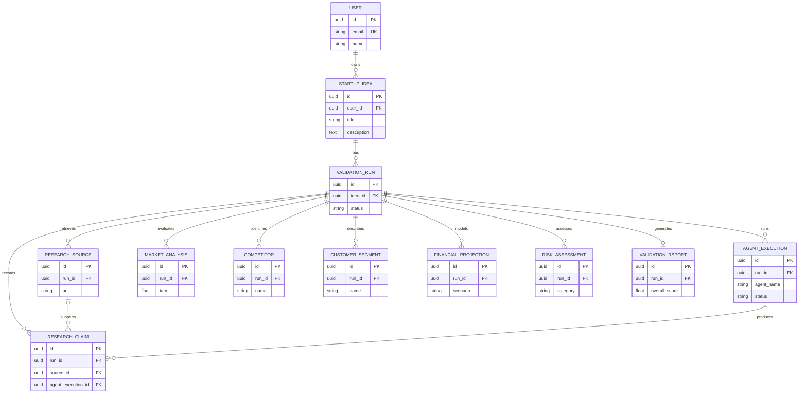
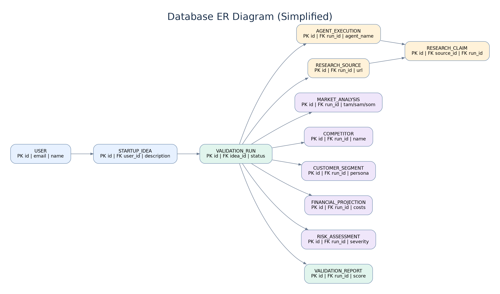

# Database Entity Relationship Diagram

**Note:** The ERD uses simplified Mermaid types for readability. Implement money and scores with PostgreSQL `NUMERIC`, not floating-point columns. Refer to `data-models.md` for detailed types and nullability.

## Visual Diagrams

