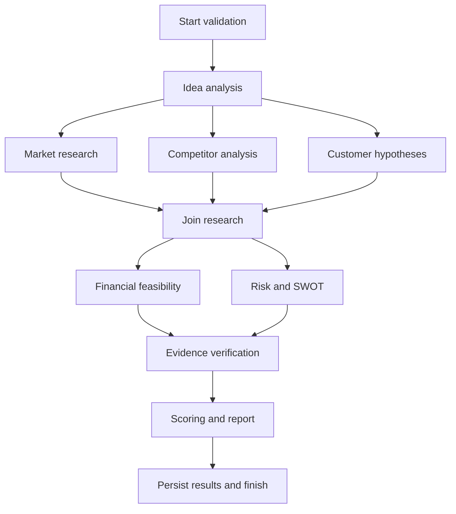
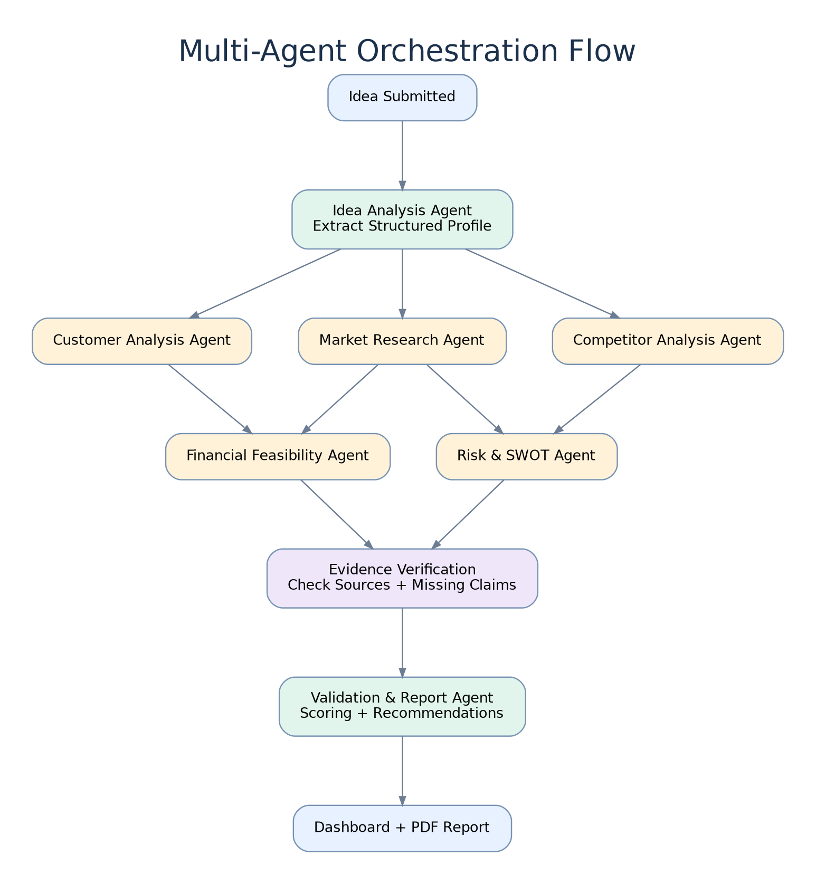
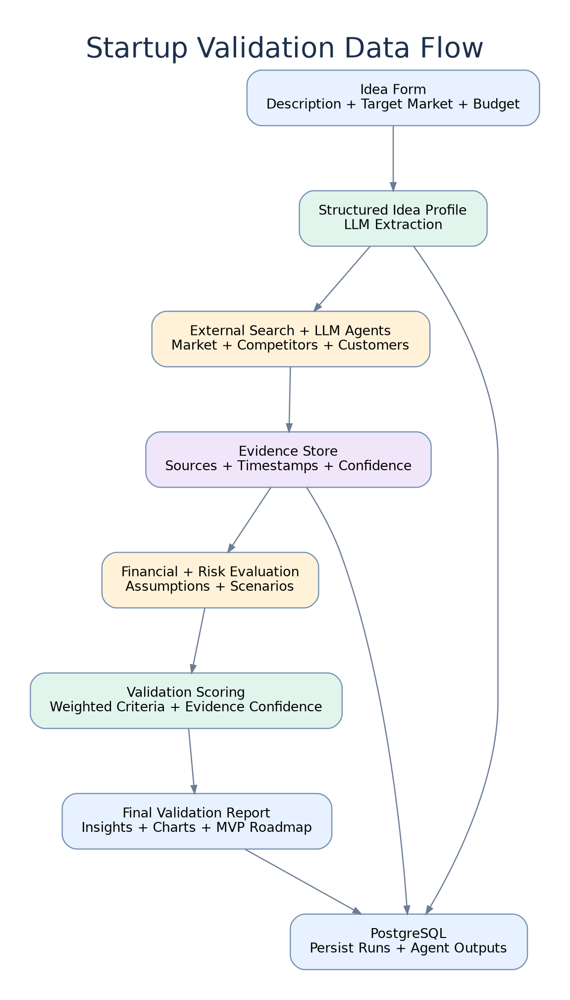

# Multi-Agent Orchestration Flow

## Workflow
1. **Create run:** API validates request and saves `ValidationRun(status=queued)`.
2. **Normalize idea:** Idea Analysis Agent extracts structured fields and unresolved questions.
3. **Parallel research:** Market Research, Competitor Analysis, and Customer Analysis execute in parallel where dependencies permit. Customer Analysis can use the normalized idea immediately and enrich its output after market/competitor results arrive.
4. **Feasibility:** Financial and Risk Agents consume available research and assumptions.
5. **Verification:** Check source provenance, missing fields, inconsistent estimates, and unsupported assertions.
6. **Scoring:** Compute weighted category scores and separate evidence confidence.
7. **Publish:** Persist report and set run status to `completed` or `partial`.

## LangGraph state (illustrative)
```python
from typing import TypedDict, Any

class ValidationState(TypedDict, total=False):
    run_id: str
    idea_id: str
    idea_profile: dict[str, Any]
    market: dict[str, Any]
    competitors: dict[str, Any]
    customers: dict[str, Any]
    financials: dict[str, Any]
    risks: dict[str, Any]
    verification: dict[str, Any]
    report: dict[str, Any]
    errors: list[str]
```

## Graph structure


## Run statuses
`queued -> running -> completed` or `partial` or `failed`; `cancelled` is optional.

## Execution guarantees
- Every run has a stable `run_id` and independently persisted agent executions.
- Parallel branches do not overwrite each other's state keys.
- Use bounded retries with backoff for temporary search/LLM errors.
- Log durations, token usage where available, and provider errors without logging secrets.
- Cache search results where allowed by the provider's terms; retain retrieval timestamps.
- On retry, avoid duplicate reports and duplicate billable tool calls where possible.

## Scoring proposal
| Dimension | Weight |
|---|---:|
| Market opportunity | 25% |
| Problem and customer demand | 20% |
| Competitive differentiation | 20% |
| Financial feasibility | 20% |
| Execution feasibility and risk | 15% |

`overall_score = sum(category_score * weight / 100)` where category scores are 0–100 and weights sum to 100. This is a decision-support heuristic, not a calibrated success probability. Track evidence confidence separately and disclose unavailable data.

## Integration test scenarios
- Idea with incomplete target geography.
- Tavily timeout or empty search results.
- Competitor page with no public pricing.
- Conflicting market-size sources.
- Two concurrent validation runs for the same idea.
- User attempts to read another user's report.

## Visual Diagrams





