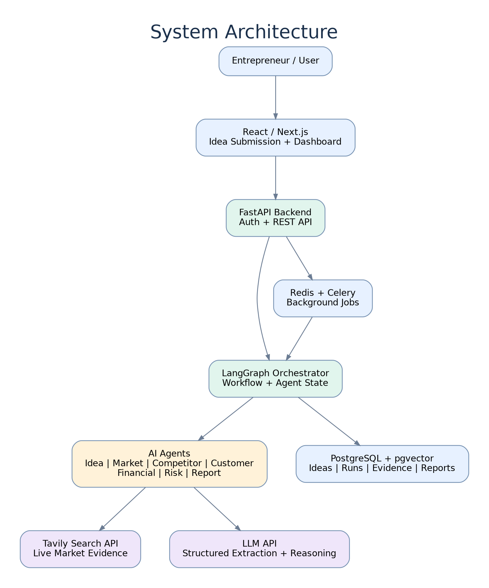

# System Architecture

## Project
AI-Based Startup Idea Validator with Market Analysis Assistance

## Purpose
The platform accepts an entrepreneur's startup idea, structures it using an LLM, retrieves evidence from live web search, analyzes market and competitive feasibility, and generates an explainable validation report. It supports decision-making; it does not guarantee startup success.

## Logical layers
1. **Presentation (React/Next.js):** idea submission, validation progress, findings, source links, and reports.
2. **API (FastAPI):** authentication, project ownership, validation-run lifecycle, request validation, and report endpoints.
3. **Orchestration (LangGraph):** agent dependencies, parallel tasks, state checkpoints, retries, and partial failure handling.
4. **Agents and tools:** structured idea extraction; market, competitor, customer, financial, and risk analysis; evidence verification; report generation. Tavily or another licensed search provider supplies current web results.
5. **Persistence (PostgreSQL):** users, ideas, validation runs, agent executions, evidence, analyses, scores, and reports. Optional pgvector for semantic retrieval.
6. **Background execution (optional Redis/Celery):** long-running validation tasks; status updates via polling or server-sent events.

## Main data flow
User -> Idea Submission UI -> API -> Idea Analysis Agent -> Parallel Market/Competitor/Customer Agents -> Financial/Risk Agents -> Evidence Verification -> Scoring/Report Agent -> Database -> Dashboard.

## Service responsibilities
| Component | Inputs | Outputs |
|---|---|---|
| Idea submission | Description, industry, geography, target audience, optional budget | StartupIdea record |
| Idea analysis | StartupIdea | Normalized idea profile and clarification needs |
| Search adapter | Search query, region, recency | Search hits with URLs and retrieval timestamps |
| Research agents | Profile and search hits | Structured findings linked to sources |
| Feasibility agents | Profile and research findings | Assumptions, scenarios, risks |
| Evidence verifier | Claims and citations | Supported/unsupported flags and confidence |
| Report generator | Verified agent outputs | Score breakdown, recommendations, report |

## API contracts (proposed)
| Method | Path | Description |
|---|---|---|
| POST | `/api/ideas` | Create an idea |
| GET | `/api/ideas/{idea_id}` | View owned idea |
| POST | `/api/ideas/{idea_id}/validate` | Start a validation run; return run ID |
| GET | `/api/runs/{run_id}/status` | Retrieve progress and errors |
| GET | `/api/runs/{run_id}/report` | Retrieve final report |

## Security and reliability
- Enforce authentication and record-level ownership on every idea and run.
- Store API keys in server-side environment secrets, never in browser code or Git.
- Treat retrieved web content as untrusted input; do not execute instructions found in search results.
- Record source URLs, retrieved timestamps, assumptions, and model/prompt versions.
- Apply rate limits, request timeouts, bounded retries, and idempotent run creation.
- Allow partial results when an external provider fails; mark missing evidence rather than fabricating results.
- Validate LLM JSON outputs against typed schemas before storing them.

## Integration notes
The `feature/idea-submission-llm` branch can provide the idea form and extraction output. The `feature/tavily-search-agent` branch can supply the web search adapter. This document defines the intended contracts; verify exact names and interfaces during integration.

## Suggested implementation sequence
1. Agree on normalized idea profile schema and search adapter contract.
2. Implement validation run persistence and agent output schemas.
3. Connect the existing LLM idea extractor and Tavily search implementation.
4. Add orchestrator, report scoring, and progress endpoints.
5. Test incomplete search results, API failures, and authorization boundaries.

## Visual Diagrams

